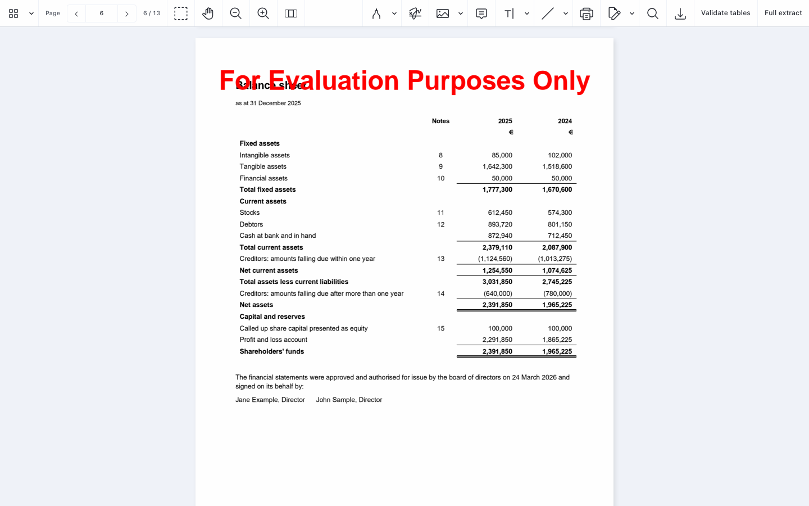
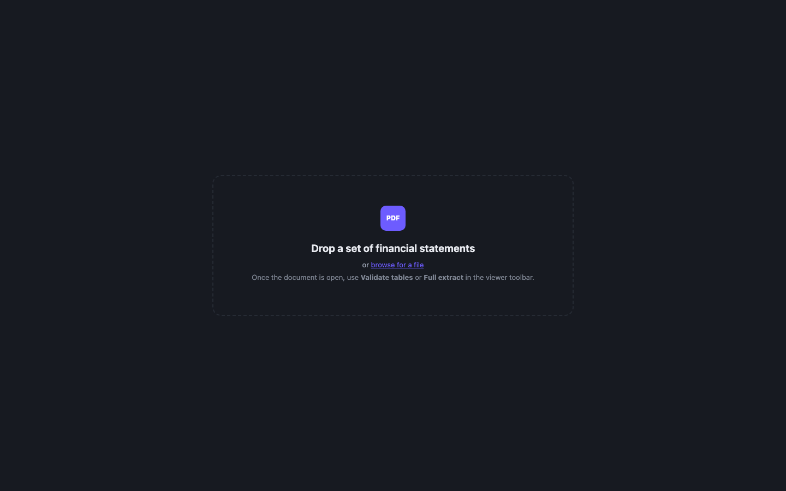

# Nutrient Financial Statement Extraction

A Nutrient.io demo that extracts the figures of a set of company financial statements with XtractFlow, checks the arithmetic of every table and highlights each value in the PDF.



1. **Input.** A PDF of statutory financial statements (profit and loss account, balance sheet, cash flow statement and notes). The field set targets accounts prepared under FRS 102, FRS 105 or IFRS. Scanned PDFs are read with OCR.
2. **Extraction.** The server runs XtractFlow (GdPicture) with an OpenAI model. The document is read in several passes that run in parallel, a few at a time:
   - one pass per section of `Spec/fields_spec.json` (company info, profit and loss, balance sheet, cash flow, notes), for the current and the prior year;
   - one pass for the commentary (directors' report, auditor's opinion, going concern) and the material notes, with a sentiment;
   - two table passes that return every row of every table: one for the primary statements, one for the notes.
3. **Checks.** Each table is checked line by line: every subtotal and total must equal the previous subtotal plus the lines in between, with a rounding tolerance. Amounts are normalised (brackets, currency, `'000` and `m` scales). The company size (micro, small, medium, large) is derived from the reporting framework or from the turnover, balance sheet total and staff numbers. Financial ratios are calculated from the extracted figures.
4. **Review.** The Nutrient Web SDK shows the PDF. The results panel lists the tables (balanced or to review), the fields and the notes. Clicking a row, a field or a note searches the document text and highlights the value on the right page.

## Prerequisites

- .NET SDK 8 or later (the project targets `net8.0`)
- An OpenAI API key
- A modern browser. The viewer loads Nutrient Web SDK 1.6.0 from the Nutrient CDN (`https://cdn.cloud.pspdfkit.com/pspdfkit-web@1.6.0/nutrient-viewer.js`), so the browser needs internet access. Nothing from the Web SDK is stored in this repository.
- Optional, for scanned PDFs only: the GdPicture OCR resources (`latin.traineddata`). They ship in the [GdPicture.Resources](https://www.nuget.org/packages/GdPicture.Resources) NuGet package, in `runtimes/any/native`. The server finds them in the local NuGet cache, or in the folder set by `OCR_RESOURCES_PATH`.

## Environment variables

Keys are only read from environment variables, never from code. Start from `.env.example`.

| Variable | Purpose | Default |
|---|---|---|
| `GDPICTURE_LICENSE_KEY` | GdPicture / XtractFlow license key | empty = evaluation mode |
| `NUTRIENT_WEB_LICENSE_KEY` | Nutrient Web SDK license key, served to the browser by `GET /api/config` | empty = evaluation mode (watermark) |
| `OPENAI_API_KEY` | OpenAI key used by XtractFlow | required for extraction |
| `OPENAI_MODEL` | `gpt-4o`, `gpt-5-mini`, `gpt-5-nano` or `o3-mini` | `gpt-4o` |
| `LLM_TIMEOUT_SECONDS` | Timeout of one LLM inference | `600` |
| `MAX_PARALLEL_BATCHES` | Extraction passes sent to the LLM at the same time | `3` |
| `OCR_RESOURCES_PATH` | Folder with `latin.traineddata`, for scanned PDFs | GdPicture.Resources in the NuGet cache |
| `ASPNETCORE_URLS` | Address the server listens on | `http://localhost:5000` |

`gpt-4o` is the default because it stays within the OpenAI SDK request timeout on long documents. `gpt-5-mini` gives slightly cleaner table structure on small documents.

## Build and run

```bash
dotnet build dotnet/FinancialExtraction.Api
```

```bash
set -a && source .env && set +a && dotnet run --project dotnet/FinancialExtraction.Api
```

Open <http://localhost:5000>.

The server serves the `frontend` folder and the API from the same origin. It sends `Cross-Origin-Opener-Policy: same-origin` and `Cross-Origin-Embedder-Policy: credentialless`, so the page is cross-origin isolated while the Web SDK still loads from the CDN.

## Sample

`samples/example-components-financial-statements-2025.pdf` is a fictitious set of financial statements (13 pages, FRS 102, euro, 2025 and 2024). Every table adds up, so all arithmetic checks should pass. It is generated by `samples/generate_financial_statements.py`:

```bash
python3 -m venv .venv && .venv/bin/pip install -r samples/requirements.txt
```

```bash
.venv/bin/python samples/generate_financial_statements.py
```

## Using the app

1. Drop a PDF on the page, or click **browse for a file**. The document opens in the viewer.

   

2. Click **Validate tables** in the viewer toolbar to read every table and check its arithmetic (one to three minutes), or **Full extract** to also read all fields, the commentary and the notes (several minutes).
3. A progress card shows the passes as they finish.
4. The results panel opens on the right:
   - the summary shows the company size, the reporting framework, the currency and the number of tables found, balanced and to review; the counters filter the table list;
   - **Tables** lists each table with its rows, their role (component, subtotal, total, memo) and the result of each check. Click a row to highlight it in the PDF, or **Show this table in the document** to highlight the whole table;
   - **Fields** lists the extracted figures for both years. Click one to highlight both values;
   - **Notes** lists the material notes with their sentiment.

## API

| Method and path | Description |
|---|---|
| `GET /health` | `{ status, gdpicture_key_set, openai_key_set, model, fields_loaded }` |
| `GET /api/config` | `{ licenseKey }` for the Web SDK |
| `GET /api/license` | GdPicture license mode (`evaluation` or `licensed`) |
| `GET /api/templates` | The XtractFlow templates and their fields |
| `POST /api/process` | multipart `file` (PDF), optional form field `openai_key`. Query: `job` (id for progress), `only=tables`, `tables=false`, `commentary=false`, `ocr=false`, `template` (an alternative template name from `/api/templates`). Returns the extraction result as JSON |
| `GET /api/progress?job={id}` | `{ known, stage, total, done, finished, elapsed_seconds }` |

The result of `POST /api/process` contains `fields` (raw and normalised values per year), `tables.detected` (rows and checks per table) and `tables.summary`, `company_size`, `review`, `notes`, `coverage`, `cost` (estimated tokens and price) and `warnings`.

## Project layout

| Path | Content |
|---|---|
| `dotnet/FinancialExtraction.Api/Program.cs` | Minimal API, XtractFlow set-up, extraction passes |
| `dotnet/FinancialExtraction.Api/Templates` | XtractFlow templates and field descriptions |
| `dotnet/FinancialExtraction.Api/Processing` | Number normalisation, sign rules, table checks, company size, ratios, cost estimate |
| `dotnet/FinancialExtraction.Api/Spec` | Field list (`fields_spec.json`) and detailed field descriptions |
| `frontend` | Single page app with the Nutrient Web SDK viewer |
| `samples` | Fictitious sample and its generator |
